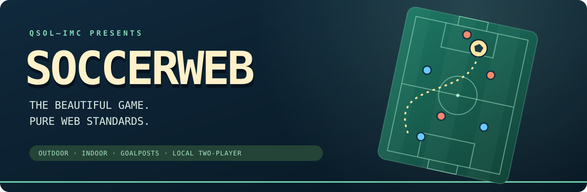

<p align="center">
  
</p>

<p align="center">
  <a href="https://qsolkcb.github.io/Soccerweb/"><strong>Play SOCCERWEB</strong></a> ·
  <a href="docs/CONTROLS.md">Controls</a> ·
  <a href="docs/CONTROLLERS.md">USB SNES setup</a> ·
  <a href="docs/TOURNAMENT-LAB-001.md">Tournament Lab</a> ·
  <a href="LICENSE">Apache-2.0</a>
</p>

Curl a shot around the keeper. Bounce a pass off the indoor wall. Chase a goal that refuses to stay put. **SOCCERWEB** is an original QSOL–IMC arcade football game built for quick matches, local rivalries and one-more-goal afternoons.

**Open the page. Pick your club. Play.** Native HTML, CSS, JavaScript modules, Canvas 2D and Web Audio—no game engine, npm build, account, backend, telemetry, external fonts or runtime network service. After a successful first load, the service worker keeps the game available offline.

| Take to the pitch | Change the rules | Bring a friend |
| --- | --- | --- |
| Outdoor **11 v 11**, rain and curling shots | Indoor **6 v 6**, quick feet and rebounding walls | Two players, independent keyboard or controller layouts |
| Eight fictional clubs, three AI levels, Cup and Challenge | **GOALPOSTS:** three stages of moving and resizing targets | Common USB SNES preset, live button/axis testing and saved remapping |

**For the curious:** the new [Tournament Lab](docs/TOURNAMENT-LAB-001.md) runs reproducible AI fixtures, turns telemetry into a review queue, and samples real browser frames. It is a developer tool; ordinary play needs none of its tooling. Local vision review is optional and disabled by default.

## Play locally

```sh
python3 -m http.server 8000
```

Open **http://localhost:8000/**. Use an HTTP server: browsers do not reliably support module imports or service workers over `file://`.

Select your club, choose a ground and press **LET’S PLAY**, or open **Practice / Skills** for six interactive drills. The default is a two-minute outdoor match. The visible match clock stops during restarts, halftime and goal replays. A keyboard or gamepad is required; touch controls are not included.

## Controls

| Action | Player 1 | Player 2 | Gamepad |
| --- | --- | --- | --- |
| Move / aim | WASD | Arrow keys | Left stick / D-pad |
| Tap pass / hold then release shot / tackle without ball | Space | Enter | A |
| Dedicated pass / first-time pass | F | Right Shift | X |
| Chip | R | Right Ctrl | B |
| Switch player | Tab | Backslash | Y |
| Bend left / right | Q / E | [ / ] | Shoulder buttons |
| Pause / resume | Escape or P | Escape or P | Start |

The controls can be remapped independently in **Settings**. Turn before releasing a shot to aim. During flight, use left/right or curve buttons for aftertouch. To play a long lofted pass, charge the kick button and press the dedicated pass button before releasing. Meet an aerial ball for a volley; kick while moving away from the opposition goal for an overhead attempt. See [the control guide](docs/CONTROLS.md).

## Inside the clubhouse

- Outdoor 11-versus-11 with throw-ins, corners, goal kicks, two halves and full time.
- Indoor 6-versus-6 with a smaller pitch, faster movement and rebounding walls.
- Quick Match, independent local two-player controls and AI-versus-AI attract mode.
- Six Practice / Skills drills and the optional three-stage outdoor GOALPOSTS challenge.
- Standard and common USB SNES controller profiles, live calibration, local remapping and menu navigation.
- Eight fictional clubs with different colours and tactical tendencies; three AI difficulties.
- Eight-team knockout Cup and seven-opponent International Challenge. Ties use golden goal. Other cup fixtures run the same simulation; they are not random score generators.
- Acceleration, physical dribbling, interceptions, charging, short/long passes, straight/curved shots, chips, volleys, overhead attempts, tackles and goalkeeper saves/rebounds.
- Rain alters traction, rolling resistance and seeded slip chances.
- Articulated procedural footballers, distinct outdoor/indoor stadiums, ball shading/trails, three camera views, minimap, CRT/mint/pixel styles and reduced-motion support.
- Six original layered music themes and impact-sensitive synthesized effects, with independent volume controls.
- Automatic slow-motion goal replays and export/import of complete tick-indexed input replays.
- Local settings and competition progress; service-worker caching for offline use after the first successful load.

## The game plays itself. The evidence tells the story.

The [Tournament Lab](docs/TOURNAMENT-LAB-001.md) uses the same deterministic football simulation as the game. Its 96 / 1,000 / 10,000-fixture presets support mirrored teams, seeded weather, safe resume and independent CPU shards. Open the resulting `index.html` locally to explore results, possession, side bias and reproducible anomaly candidates.

```sh
mkdir -p work
node tools/tournament_lab.mjs --out work/tournament-quick --verify
# An explicit, bounded 1,000-match sweep:
node tools/tournament_lab.mjs --preset medium --budget-seconds 1200 --out work/tournament-1000
```

**Measured:** [1,000 complete matches in 432 seconds](docs/evidence/tournament-lab/README.md), with 12 exact reruns. The [lab guide](docs/TOURNAMENT-LAB-001.md) records the source, host, limitations and commands for sparse Chromium/Firefox captures. A 10,000-fixture preset is a supported limit, not a claim that it has been benchmarked. No model downloads, GPU jobs or remote inference happen automatically.

## Verification

The game needs no Node installation. The optional native regression suite uses Node's built-in test runner, without packages:

```sh
node --test tests/*.test.mjs
python3 tests/package.py
```

The real Chromium/Firefox smoke suite is a **development-only** Python dependency:

```sh
python3 -m venv work/test-env
work/test-env/bin/pip install playwright==1.56.0
work/test-env/bin/python -m playwright install chromium firefox
work/test-env/bin/python tests/browser_smoke.py
work/test-env/bin/python tests/goalposts_browser.py
BROWSER=firefox work/test-env/bin/python tests/goalposts_browser.py
```

Linux hosts may also need `python -m playwright install --with-deps chromium firefox`. CI uses Ubuntu 24.04. The browser suite serves the game under a repository subpath and checks real keyboard movement, shooting, pause/resume, full time, replay export/import/playback, indoor P2 input, saved settings and an offline reload/match. Screenshots, RAF timings, seeded gameplay reports, audio event traces/reference WAVs and the actual match replay are uploaded as CI artifacts. High DPI, reduced motion, display options and live audio pause/resume are also checked. The matchday suite also uses sustained human-control inputs, virtual Gamepad API devices, all practice drills, separate CPU stage measurements and captured live Web Audio. See [verification evidence and limits](docs/VERIFICATION.md).

## GitHub Pages

[`.github/workflows/pages.yml`](.github/workflows/pages.yml) tests every PR. A push of relevant game files to `main`, or a manual run on `main`, deploys the static artifact **only after both regression and real-browser checks pass**. Feature-branch runs and pull requests cannot deploy. Pages must use **GitHub Actions** as its source (already configured for this repository).

The play link opens the version deployed from verified `main`. Feature-branch changes appear only after owner review, merge and a successful deployment. Tournament scripts, models, raw evidence and the README banner are development/documentation assets; they are excluded from the packaged game.

The worker precaches only local runtime assets, retains a coherent app version, and removes only this repository's old caches. New workers wait until older tabs close; reopen the game to activate an update. Bump the cache version in `sw.js` whenever runtime files change. Browser installation UI varies; cached play does not require installation.

## Engineering and release status

Read [architecture and numeric rules](docs/ARCHITECTURE.md), [release notes](docs/RELEASE-NOTES.md), and [verification](docs/VERIFICATION.md). Version 3.1 adds [GOALPOSTS](docs/GOALPOSTS.md) and [controller calibration](docs/CONTROLLERS.md), preserving the Phase 3 action/possession, training and indoor improvements. See the [Phase 3 evidence](docs/PHASE-3.md) and [owner acceptance script](docs/MANUAL-QA.md). Historical Phase 2 evidence remains available. Manual multi-browser, physical gamepad, audio listening and extended balance reviews remain part of the next engineering pass. Rules intentionally omit offside, fouls, cards, substitutions and penalty shootouts. Replay hashes detect accidental divergence, not adversarial tampering.

Historical references: [MicroProse Soccer overview](https://en.wikipedia.org/wiki/MicroProse_Soccer) and [C64 Wiki mechanics](https://www.c64-wiki.com/wiki/Microprose_Soccer). This is independent software: no original source, sprites, team data, recordings, melodies or branding are included.
