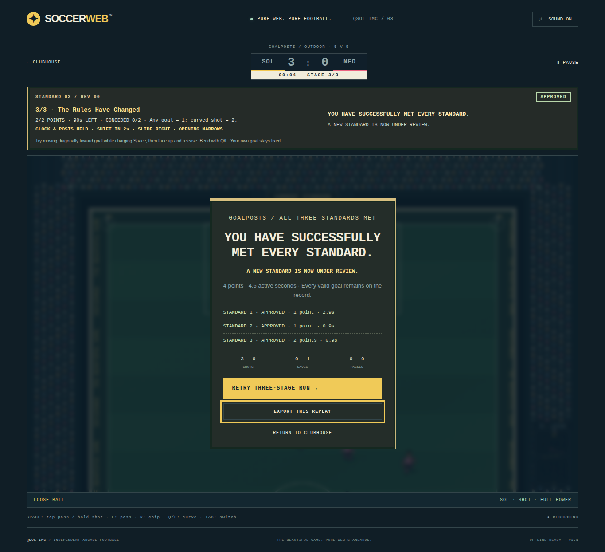
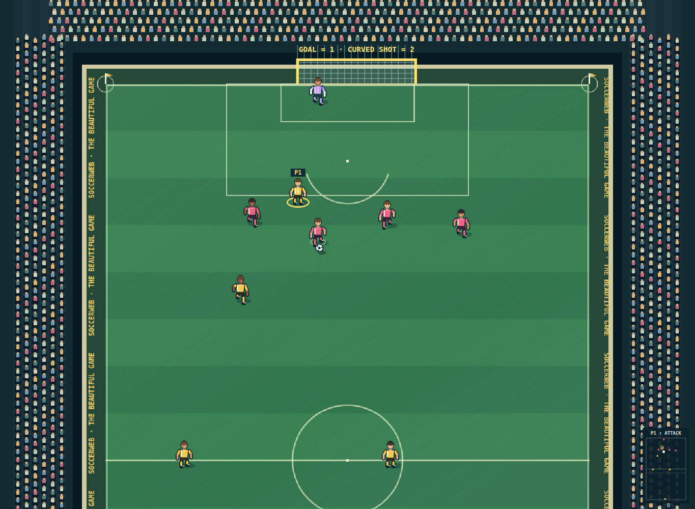
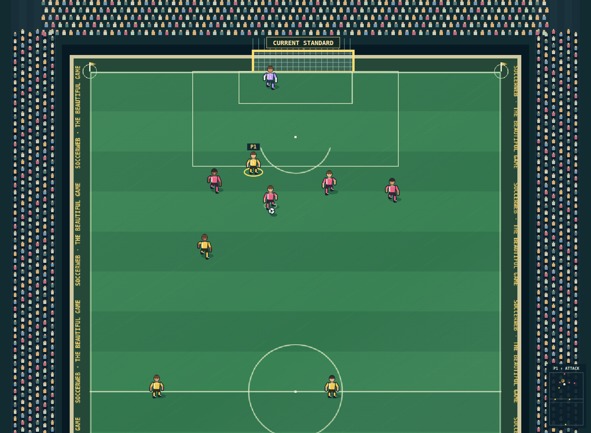

# Standards polish evidence

Baseline: merged main / PR #10, `b9db46ab9b42cb2c3e98d2af82c10eed0b309128`.

- **PASS:** 143 native tests, including 12 unchanged v5 normal fixture results and six unchanged complete GOALPOSTS routes/checkpoints, announcement cooldown/event/mutation tests, sign geometry, original SFX bounds, complete host finale/retry and existing regressions.
- **PASS:** 30 local runtime files packaged; runtime imports and offline inventory checked.
- **PASS:** Chromium 141.0.7390.37 and Firefox 142.0.1 live all-stage runs, exact finale/ledger, keyboard and virtual-SNES controls, focus, narrow reduced-motion results, export/worker verification/playback, failure/retry, best/profile/cup isolation and offline Pages-subpath reload; no JavaScript errors.
- **PASS:** 14 matched screenshots per browser (seven before/after pairs). Each pair has identical tick, hash, camera, geometry and player coordinates. Current signage is centred above the opening and inside the viewport.
- **PASS:** Tournament Lab smoke / exact 96-fixture regression, [run 43703287953](https://github.com/QSOLKCB/Soccerweb/actions/runs/43703287953).
- **NOT RUN:** human playtesting, manual listening, physical USB SNES hardware, Safari/WebKit and laptop/GPU profiling.

Initial browser attempt: [run 43702343462](https://github.com/QSOLKCB/Soccerweb/actions/runs/43702343462), feature source `dee6a6bd72095b9564067bede0800355a7f69199`, tested merge `0526efe3b4f811f2a469d0bf8c67edbd6bf595f6`. Chromium **PASS** (1,084 ticks, replay `b68eeb8a`). Firefox **FAIL** waiting for the first stage-clear overlay after the opening shot was parried; comparison steps were consequently not reached. The [original artifact](https://github.com/QSOLKCB/Soccerweb/actions/runs/43702343462/artifacts/14156613048) retains that screenshot. The subsequent test change synchronizes the opening virtual-SNES input at sampling, retains keyboard stage-two coverage and saves diagnostic state/replays on failure. Gameplay is unchanged; this attempt is not represented as a Firefox pass.

The committed `native-before.json` is the exact merged-main reference; native tests require the new source to match it without version normalization. Browser probes and full live gameplay captures are separate, labelled evidence. See [implementation and reproduction](../../GOALPOSTS-POLISH-001.md).

Follow-up repeat: [run 43704145178](https://github.com/QSOLKCB/Soccerweb/actions/runs/43704145178), source `f9a469c91c1665842a71e7aedcd72d09dc34591a`, **FAIL** in Chromium stage two; [diagnostic artifact](https://github.com/QSOLKCB/Soccerweb/actions/runs/43704145178/artifacts/14158350447). Stage one cleared correctly. The failure replay verifies as `281cd847`: stage two charged for 45 ticks versus 44 in the saved passing run, producing a different shot position. Paired captures still passed in both browsers. The final harness synchronizes all scoring-stage controls at sampling, and separately checks trusted keyboard movement/charge/shooting plus partial replay export/import. It does not extend the timeout or retry until a shot happens to score.

Review also identified partial replay completion incorrectly showing timeout text for `playing`/`cleared` statuses. The host now uses neutral recording-complete copy for those statuses and reserves failure explanations for `failed`. Three additional native cases cover a verified 150-tick partial, a stage-cleared partial and a genuinely failed recording. The archived winning screenshots/replay below predate that UI-only fix and remain valid; final-head results are linked from the PR. Native test count after this fix is **146**.

## Successful browser evidence

[Run 43703287983](https://github.com/QSOLKCB/Soccerweb/actions/runs/43703287983), GOALPOSTS job **PASS**, feature source **`ff90756fecf1794463a51ff62a98c2d76a531d8a`**, tested merge **`d7c9b04ae7ac2dfe4381bd97c931395ed1f51d8c`**. The subsequent evidence commit changes documentation only. See [PR #11 checks](https://github.com/QSOLKCB/Soccerweb/pull/11/checks) for the final head's full regression gate.

[Complete artifact](https://github.com/QSOLKCB/Soccerweb/actions/runs/43703287983/artifacts/14157174860), ZIP SHA256 `16de5ec5a98262f2a91aa8dd10b7249b6d585befa5ef0f098b66f00c33f020df`. Selected original files are committed here; [artifact-index.json](artifact-index.json) records their hashes and sources. Reports list additional captures available in the complete artifact.

| Evidence | Chromium | Firefox |
| --- | --- | --- |
| Live run and capture ticks | [report](chromium/report.json) | [report](firefox/report.json) |
| Paired geometry/camera/capture metadata | [report](chromium/comparison/report.json) | [report](firefox/comparison/report.json) |
| Whole-run replay | [v5, 1,089 ticks, `b9268fbf`](chromium/goalposts-replay.json) | Same final hash and tick count; full recording in artifact |
| Victory | [full-size screenshot](chromium/victory.png) | [full-size screenshot](firefox/victory.png) |

The saved live screenshots use a **1365×1000 viewport** and full-page capture: [stage 1](chromium/stage-1.png) (ticks 272–279), [stage 2](chromium/stage-2.png) (611–615), [stage 3](chromium/stage-3.png) (933–939), [victory](chromium/victory.png) (1,089, stopped), and [390×720 reduced-motion results](chromium/victory-narrow-reduced.png). Live capture intervals differ between browsers and are retained in their reports; they are not fixed-tick before/after comparisons.

## Matched before/after comparison

These are **Canvas-only** screenshots from the actual production renderer, using identical replayed inputs and 120 camera warmup frames. They do not contain the app HUD. All three stages were paired at 1365×1000, at active clock 180: stage 1 tick 300 / `61523316`, stage 2 tick 742 / `9be956cb`, stage 3 tick 1,065 / `e3ade08c`. No positions, scores or stage transitions were injected. Baseline is merged main `b9db46ab9b42cb2c3e98d2af82c10eed0b309128`; current source is the tested merge above.

| Stage 3 before — 1365×1000 | Stage 3 after — 1365×1000 |
| --- | --- |
|  |  |

The sign now reads **CURRENT STANDARD** in the last stage too. The rule remains in the live HUD. The matched geometry, camera and player coordinates demonstrate that legibility did not come from enlarging the footballers or changing the view.

Additional original captures: [390×720 reduced motion](chromium/comparison/narrow-reduced-after.png), [1920×1080 wide/minimal](chromium/comparison/wide-minimal-after.png), [pixel mode](chromium/comparison/pixel-after.png), [Firefox 900×900 DPR2](firefox/comparison/dpr2-after.png). The artifact retains their before images and both browsers' complete sets. Screenshots were visually inspected for sign placement, contrast, unchanged scale and legible overlays; this is not human gameplay or audio listening QA.
